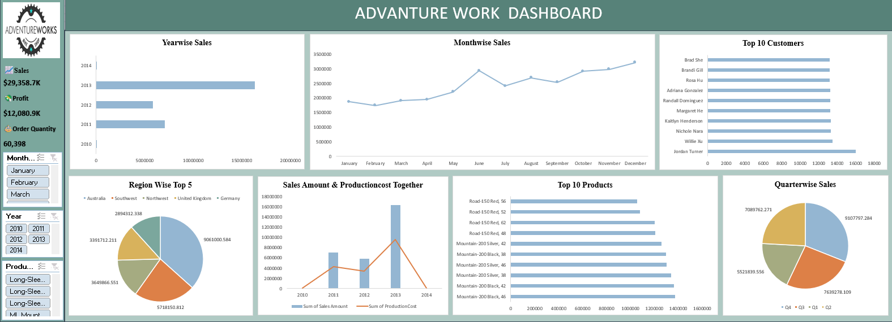
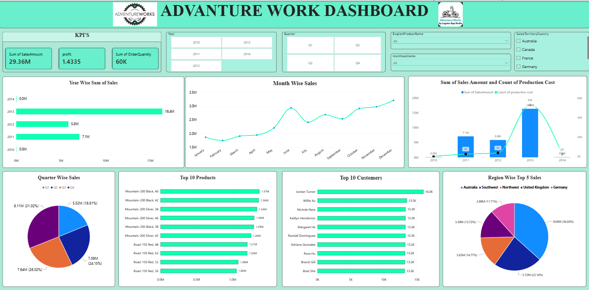
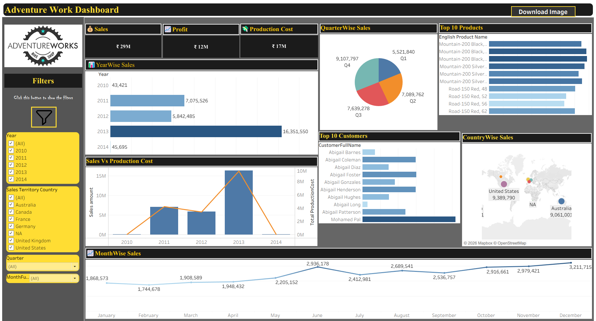

# Adventure Works Sales Performance Analysis

End-to-end analysis of Adventure Works Cycles sales data (2010-2014) using **Excel, MySQL, Power BI and Tableau**.

## Project Overview
Adventure Works Cycles is a multinational bicycle manufacturer operating across North American, European and Asian markets, headquartered in Bothell, Washington. This group project answers client business questions about sales, profit, products, customers and regions, and presents the results in interactive dashboards.

## My Role
I independently completed this project end to end: combined and cleaned the data in MySQL (UNION ALL, joins, calculated Sales Amount, Production Cost and Profit), built the Excel dashboard with pivot tables and slicers, designed the Power BI dashboard with KPI cards and drill down, and created the Tableau visualizations.

**Data model (star schema):** `Fact_Sales` linked to `DimCustomer`, `DimProduct`, `DimDate` and `DimSalesTerritory`.

## Key Metrics
| Total Sales | Profit | Production Cost | Total Orders | Profit Margin |
|---|---|---|---|---|
| 29.36M | 12.08M | 17.28M | 60K | 41.15% |

## Dashboard Preview
### Excel Dashboard


### Power BI Dashboard


### Tableau Dashboard


## Tools Used
| Tool | What was done |
|---|---|
| Excel | Pivot tables, charts and slicers (Year, Region, Category) in an interactive dashboard |
| Power BI | Interactive dashboard with KPI cards, filters and drill down |
| Tableau | Interactive dashboard with year, country, quarter and month filters, and a country sales map |
| MySQL | Combined the fact tables with UNION ALL, joined product, customer and territory tables, created date columns, and calculated Sales Amount, Production Cost and Profit |

## Dashboards
Each dashboard shows year-wise, quarter-wise and month-wise sales, top 10 products, top 10 customers, region-wise sales, and sales vs production cost.

- **Excel:** pivot tables, charts and slicers
- **Power BI:** KPI cards, slicers and drill down
- **Tableau:** filters and a country-wise sales map

All three dashboards are in the project presentation: [Adventure Work final PPT (ADV).pdf](presentation/Adventure%20Work%20final%20PPT%20%28ADV%29.pdf)

## SQL Queries
| Query | Purpose |
|---|---|
| Q0 | Union of both fact tables into one view (`combined_fact_tables`) |
| Q1 | Product name and unit price from the product table |
| Q2 | Customer full name from the customer table |
| Q3 | Date columns (year, month, quarter, weekday, financial month and quarter) from OrderDateKey |
| Q4-Q6 | Sales Amount, Production Cost and Profit |
| Q7-Q9 | Monthly, year-wise and month-wise sales |
| Q10 | Quarter-wise sales |
| Q11 | Sales vs production cost by year |
| Q12 | Top 10 products, top 10 customers, region-wise sales |
| Q13 | Overall KPIs (total sales, production cost, profit) |

SQL concepts used: joins, GROUP BY, aggregate functions, date functions, CTEs, views, CASE statements.

## Key Insights
1. **Peak year is 2013:** about 16.4M in sales, roughly 2.8x higher than 2012, with strong growth from 2011 onward. 2010 and 2014 have very little data.
2. **Top region is Australia:** 9.06M in sales (36.7% of the top 5 regions), followed by Southwest (5.72M) and Northwest (3.65M).
3. **Top products are mountain bikes:** Mountain-200 Black and Silver models lead the top 10, with Mountain-200 Black (46) at about 1.37M.
4. **Top customers are closely ranked:** the top 10 customers each bought about 13K-16K, led by Jordan Turner.
5. **Q4 is the strongest quarter:** 9.11M (31.0% of sales), and December is the best month at about 3.21M.
6. **Healthy margin:** production cost stays well below sales across all months, giving a stable profit margin of 41.15%.

## Repository Structure
```
Adventure_work_sales_analysis/
├── data/           datasets used in the project
├── presentation/   final project presentation (PDF)
├── Questions/      client questions
└── README.md
```

## Project Team (Group 01)
- M. Posibabu
- Savita Gowtam
- R. Jagadeesh
- S. Bhaskar Sai Charan

## Author
**Menni Posibabu**, 
Aspiring Data Analyst | Excel, MySQL, Power BI, Tableau
LinkedIn: (www.linkedin.com/in/posibabumenni)
GitHub: [posi19babu](http://github.com/posi19babu)
email: posibabu414@gmail.com
